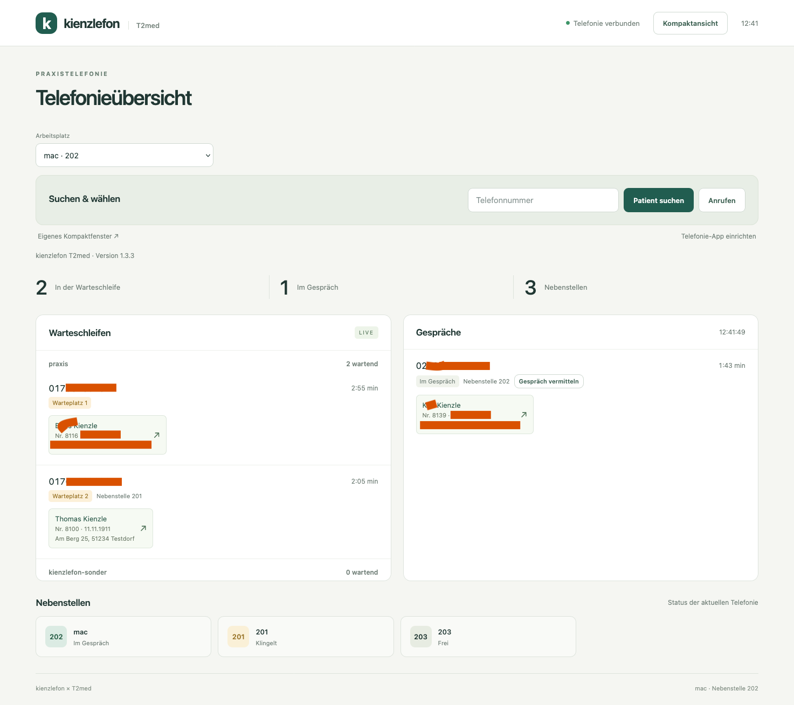
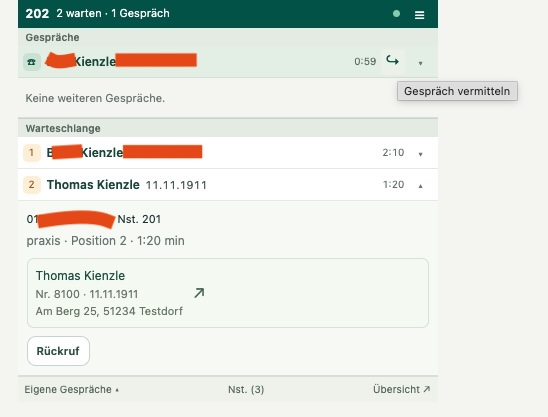
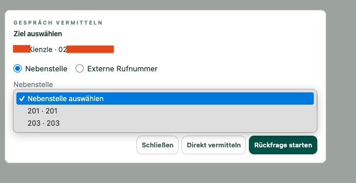

[](https://youtu.be/kX2JQL1cnUw)

**[▶ Demovideo auf YouTube ansehen](https://youtu.be/kX2JQL1cnUw)**

# kienzlefon-t2med

> [!WARNING]
> **Nicht für diesen Zweck vorgesehene Schnittstelle:** Der Aktenaufruf nutzt die GDT-/Kalenderanbindung von T2med für die Telefonie-Anbindung. Diese Schnittstelle ist dafür nicht vorgesehen. T2med-Updates können das Verhalten ändern oder die Funktion unterbrechen. Den Aktenaufruf vor dem Praxiseinsatz und nach T2med-Updates am jeweiligen Arbeitsplatz prüfen.

Anrufer erkennen, Warteschlangen und Gespräche im Blick behalten und die passende Patientenakte mit einem Klick öffnen: kienzlefon-t2med verbindet Asterisk mit T2med über eine zentrale PHP-Middleware.

**Version 1.3.6 · von Dr. Thomas Kienzle** · [Änderungen](CHANGELOG.md)

[Installation](docs/INSTALLATION.md) · [Bedienung und Weblinks](docs/WEB.md) · [Telefonie-App für Windows, macOS und Linux](docs/CLIENTS.md) · [Asterisk-Einrichtung](docs/AMI_DIALPLAN.md)

## So sieht es aus

### Vollständige Telefonieübersicht

Warteschlangen, laufende Gespräche und Nebenstellen stehen in einer gemeinsamen Ansicht. Die Rufnummernsuche und die Arbeitsplatzwahl sind direkt erreichbar. Ein Klick auf einen eindeutig zugeordneten Patientennamen übergibt dessen Akte an den gewählten T2med-Arbeitsplatz.



*Die bereitgestellten Bildschirmaufnahmen zeigen einen früheren Oberflächenstand, in der Übersicht Version 1.3.3. Die aktuelle Version 1.3.6 ergänzt unter anderem die Rückrufverwaltung sowie Autor und Version im Footer.*

### Kompakt am Arbeitsplatz

Die schmale Ansicht zeigt eigene Gespräche und wartende Anrufer. **Alle Gespräche** blendet die Verbindungen der anderen Nebenstellen ein; **Eigene Gespräche** schaltet zurück. Die Auswahl bleibt während der Tab-Sitzung erhalten. Details und mehrere passende Patienten lassen sich aufklappen.



*Der im älteren Screenshot sichtbare Rückrufknopf an einem laufenden Anruf entfällt seit 1.3.6. Rückrufaufträge werden im Menü verwaltet. Ohne aufgeklappte Details reichen bei einem eigenen Gespräch und zwei Wartenden ungefähr 250 × 210 Pixel Inhaltsfläche.*

### Intern und extern vermitteln

Der kleine Pfeil **↪** am eigenen verbundenen Gespräch öffnet die Zielauswahl. Möglich sind eine andere Nebenstelle oder eine externe Rufnummer, jeweils direkt oder mit Rückfrage.



Eine laufende Rückfrage wird in der vollständigen **Übersicht** abgeschlossen oder abgebrochen. Die Kompaktansicht zeigt keinen separaten Vermittlungsverlauf. Voraussetzung ist die [Vermittlungseinrichtung im Telefonprojekt](docs/TRANSFER_HANDOFF.md).

## Was die Middleware übernimmt

| Funktion | Verhalten |
| --- | --- |
| Anrufer erkennen | APS sucht nach der Rufnummer. Mehrere passende Patienten bleiben getrennt und werden zur Auswahl angeboten. |
| Namen am Telefon anzeigen | Bei eindeutiger Zuordnung erhält Asterisk den Namen. Der Dialplan wartet vor dem Klingeln höchstens eine Sekunde; bei Fehlern oder Mehrdeutigkeit bleibt die Rufnummer erhalten. |
| Patientenakte öffnen | Ein Patientenklick oder Aktenlink erzeugt `AUFRUFi.gdt` im Verzeichnis des gewählten Arbeitsplatzes. T2med übernimmt den Aktenaufruf. |
| Wählen | Zuerst klingelt die eigene Nebenstelle. Nach dem Abheben wählt Asterisk die Zielnummer. |
| Telefonie-App | Registrierte `tel:`-/`callto:`-Links wählen unter Windows, macOS und Linux ohne Rückfrage oder Browserfenster. |
| Rückrufaufträge verwalten | **Nochmal versuchen**, **Löschen** und **Liste bereinigen** stehen für den gewählten Arbeitsplatz bereit. Löschen beendet keinen Anruf. |

## Aufbau und Voraussetzungen

Der zentrale Dienst läuft auf **Debian 12+, Ubuntu 24.04+ oder Raspberry Pi OS Bookworm+** mit systemd und PHP 8.2+. ReactPHP liefert die Weboberfläche selbst aus; eine Datenbank oder ein zusätzlicher Webserver ist nicht erforderlich.

| Bestandteil | Aufgabe |
| --- | --- |
| Asterisk / kienzlefon | Gespräche, Warteschlangen, AMI und Dialplan. Die Asterisk-seitige Einrichtung erfolgt im [kienzlefon-Projekt](https://github.com/thomaskien/kienzlefon). |
| T2med / APS | Patientensuche und Personendaten über den bestätigten APS-Suchendpunkt. |
| Middleware | Verbindet AMI und APS, liefert die Webansicht aus und schreibt die GDT-Dateien. |
| Arbeitsplatz | Browser, lokale Nebenstellenzuordnung und T2med-Kalenderanbindung zum jeweiligen GDT-Verzeichnis. |

Asterisk, APS und Middleware dürfen auf demselben oder auf getrennten Servern laufen. Die Weboberfläche benötigt keine Anmeldung und ist für das abgeschottete Praxisnetz vorgesehen. Der Installer richtet die Guestfreigabe **`kienzlefon-GDT`** ein und erhält dabei bestehende Samba-Freigaben. Einzelheiten zu kompatiblen Samba-Einstellungen stehen in der [Installationsanleitung](docs/INSTALLATION.md#samba-und-gdt).

## In Betrieb nehmen

1. **Telefonserver vorbereiten:** AMI und Dialplan gemäß [Asterisk-Vertrag](docs/AMI_DIALPLAN.md) einrichten; für Vermittlung zusätzlich die [Transfer-Ergänzung](docs/TRANSFER_HANDOFF.md).
2. **T2med-Zugang vorbereiten:** Einen für die Patientensuche geeigneten Benutzer verwenden. Die [APS-Einrichtung mit Screenshot der Rechteansicht](docs/INSTALLATION.md#t2med-benutzer-und-aps) beschreibt die Prüfung.
3. **Middleware installieren:** Auf dem vorgesehenen Linux-Server ausführen:

   ```sh
   git clone https://github.com/thomaskien/kienzlefon-t2med.git
   cd kienzlefon-t2med
   sudo bash installer/install.sh
   ```

4. **Arbeitsplätze zuordnen:** Der Installer fragt pro Arbeitsplatz Client-ID, Bezeichnung, Nebenstelle und GDT-Verzeichnis ab. Die [GDT-Vorlage „Telefonaufruf“](#gdt-vorlage-für-t2med) in T2med übernehmen und die Kalenderanbindung auf dessen `AUFRUFi.gdt` einstellen.
5. **Webansicht öffnen:** Die im Installer festgelegte Middleware-Adresse aufrufen, Arbeitsplatz auswählen und die Patientensuche mit einer bekannten Rufnummer prüfen. Für `tel:`-/`callto:`-Links im Menü **Telefonie-App einrichten** den passenden Client installieren.

Der Installer fragt auch APS- und AMI-Server samt Zugangsdaten sowie die öffentliche Middleware-URL ab. Die Serverkonfiguration liegt in `/etc/kienzlefon-t2med/config.toml`; der Dienst heißt `kienzlefon-t2med.service`.

Beispiel für die GDT-Freigabe:

```text
kienzlefon-GDT/
  empfang-1/AUFRUFi.gdt
  empfang-2/AUFRUFi.gdt
```

Client-ID, Nebenstelle und Verzeichnis gehören zusammen: `empfang-1` kann beispielsweise Nebenstelle `201` und das Verzeichnis `empfang-1` verwenden. Eine noch nicht importierte GDT-Datei wird durch den neuesten Aktenaufruf ersetzt. Die Webmeldung bestätigt die Dateiübergabe; die tatsächliche Aktenanzeige übernimmt T2med.

### GDT-Vorlage für T2med

**[GDT-Vorlage „Telefonaufruf“ herunterladen](https://raw.githubusercontent.com/thomaskien/kienzlefon-t2med/main/docs/templates/GDTGeraet_Telefonaufruf_Konfiguration.json)** · [Datei im Repository ansehen](docs/templates/GDTGeraet_Telefonaufruf_Konfiguration.json)

Die JSON-Datei enthält die T2med-Gerätekonfiguration für den Aktenaufruf. Die mitgelieferten Stationspfade beziehen sich auf den macOS-Arbeitsplatz `mac`; Import-/Exportverzeichnis und Programmzuordnung nach dem Import an den jeweiligen Arbeitsplatz anpassen. Die einzelnen `AUFRUFi.gdt`-Dateien mit der Patientennummer erzeugt anschließend die Middleware.

Die [Importanleitung mit den einzustellenden Werten](docs/INSTALLATION.md#gdt-vorlage-in-t2med-importieren) führt durch die Einrichtung.

### Aktualisieren

Im vorhandenen Projektverzeichnis auf dem Middleware-Server:

```sh
git pull --ff-only
sudo bash installer/install.sh --keep-config
```

Anschließend die Webansicht neu laden. Für Änderungen an Arbeitsplätzen oder Verbindungen `--reconfigure` statt `--keep-config` verwenden. Ein normaler Installationslauf fragt bei vorhandener Konfiguration nach Änderungswünschen. Eine ältere Serverkonfiguration in JSON wird nach TOML übernommen; die ursprüngliche Datei bleibt erhalten. Bereits installierte Desktop-Clients werden mit ihrem jeweiligen [Client-Installer](docs/CLIENTS.md#aktualisierung-und-prüfung) aktualisiert.

## Links in andere Oberflächen einbauen

Basisadresse und Client-ID durch die eigene Einrichtung ersetzen. `telefon` enthält die URL-kodierte Rufnummer; ein führendes `+` wird zu `%2B`.

**Direkt wählen, ohne zusätzliche Bestätigung:**

```text
http://middleware.example:8765/waehlen?client_id=empfang-1&telefon=%2B493055501111&sofort=1
```

**Patientenakte anhand der Rufnummer öffnen:**

```text
http://middleware.example:8765/patient-oeffnen?client_id=empfang-1&telefon=%2B493055501111
```

Bei mehreren Patiententreffern erscheint eine Auswahl. Neuladen und Zurücknavigation wiederholen keinen Auftrag. Die Weblinks öffnen eine Browserseite; für die Wahl ohne Browserfenster dienen die registrierten `tel:`-/`callto:`-Links. [Details zu Weblinks](docs/WEB.md#wähl--und-aktenlinks-für-kienzlefon)

## Demo ohne Telefonanlage

Für die Entwicklung oder zum Ausprobieren mit PHP und Composer:

```sh
composer install
php bin/server.php --demo --listen=127.0.0.1:8765
```

Danach `http://127.0.0.1:8765/` öffnen. Die Demo verwendet fiktive Daten und erzeugt weder Telefonate noch GDT-Dateien. Der Schalter `--demo` gilt für den gesamten Prozess; eine URL kann einen produktiven Dienst nicht in den Demomodus umschalten.

## Weitere Dokumentation

| Thema | Anleitung |
| --- | --- |
| Server, APS-Benutzer, Samba/GDT, Updates und Diagnose | [Installation und Betrieb](docs/INSTALLATION.md) |
| Kompaktansicht, Patientenauswahl, Rückrufaufträge und Vermitteln | [Bedienung und Weblinks](docs/WEB.md) |
| Registrierung als Telefonie-App | [Windows, macOS und Linux](docs/CLIENTS.md) |
| AMI und Dialplan | [Vertrag für den kienzlefon-Installer](docs/AMI_DIALPLAN.md) |
| Direkte Vermittlung und Rückfrage | [Ergänzung für das Telefonprojekt](docs/TRANSFER_HANDOFF.md) |
| Konfiguration und HTTP-API | [Architektur](docs/ARCHITECTURE.md) |
| Automatische Tests und praktische Abnahme | [Tests](docs/TESTING.md) |

Gesprächszustand und Auftragskennungen liegen im Arbeitsspeicher. Nach einem Dienstneustart werden aktive Gespräche neu eingelesen; frühere Rückrufaufträge werden nicht wiederhergestellt. Bei ungewissem Ergebnis erfolgt keine automatische Wahlwiederholung. Die Prüfung mit echter Telefonanlage, SMB und T2med ergänzt die automatisierten Tests mit simulierten Systemen.
