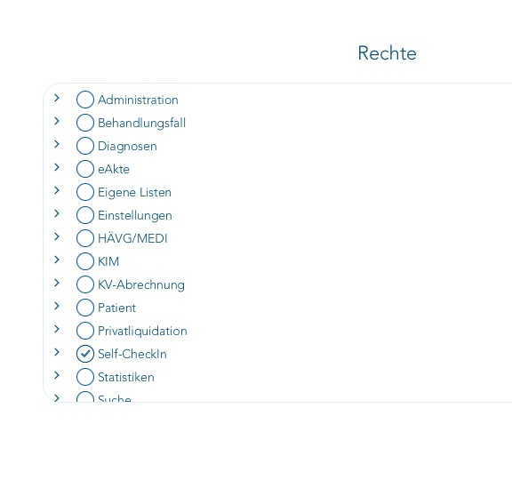

# Installation und Betrieb

[← Projektübersicht und Demovideo](../README.md) · [Bedienung](WEB.md) · [Desktop-Clients](CLIENTS.md)

## Vorab bereitlegen

| Zugang oder Einstellung | Benötigte Angaben |
| --- | --- |
| T2med / APS | Vom Middleware-Server erreichbarer Host, Port, Benutzername, Passwort und TLS-Einstellung; üblicher APS-Port: `16567`. |
| Asterisk / AMI | Erreichbarer Host, Port, AMI-Benutzer, dessen Secret und TLS-Einstellung; üblicher AMI-Port: `5038`. |
| Middleware | Adresse für die Arbeitsplätze, freier HTTP-Port und lokales GDT-Verzeichnis. |
| Arbeitsplätze | Jeweils Client-ID, Bezeichnung, Nebenstelle und Unterverzeichnis für GDT. |

APS-Passwort und AMI-Secret sind getrennte Zugangsdaten. Der Middleware-Installer legt diese Konten nicht in T2med oder Asterisk an. AMI und Dialplan werden über das [kienzlefon-Telefonprojekt](AMI_DIALPLAN.md) eingerichtet.

## T2med-Benutzer und APS

Für die Patientensuche ein dafür vorgesehenes T2med-/APS-Konto verwenden. Der Installer fragt dessen Benutzername und Passwort ab. Ein ausdrücklich leeres Passwort wird unterstützt. Die Suche berücksichtigt die Sichtbarkeit der Patienten (`ignoreSichtbarkeit = false`); ein erfolgreicher Login allein beweist deshalb noch nicht, dass das Konto die benötigten Patienten findet.



*Beispiel der T2med-Rechteansicht aus der bereitgestellten Installation. Im Ausschnitt ist „Self-CheckIn“ markiert. Daraus lässt sich kein vollständiges Mindestprofil für APS ableiten; weitere und gegebenenfalls geerbte Rechte sind hier nicht vollständig zu sehen.*

Nach der Middleware-Installation die APS-Verbindung mit dem unten beschriebenen [Verbindungstest](#betrieb-und-diagnose) prüfen. Anschließend in der Weboberfläche eine bekannte Rufnummer suchen und die erwarteten Patienten kontrollieren. Bei mehreren Treffern jeden Kandidaten prüfen; identische Namen werden nicht automatisch zusammengeführt. Für den Aktenaufruf muss zusätzlich die Kalenderanbindung am T2med-Arbeitsplatz eingerichtet sein.

Bei einem selbstsignierten APS-Zertifikat kann im Installer die TLS-Prüfausnahme für den vereinbarten Integrationstest gewählt werden. Alternativ lässt sich über `aps.ca_file` eine vertrauenswürdige CA hinterlegen. Die Ausnahme wird nicht automatisch aktiviert.

## Server vorbereiten

Unterstützt werden Debian 12+, Ubuntu 24.04+ und Raspberry Pi OS Bookworm+ (arm64/armhf) mit systemd und PHP 8.2 oder neuer. Fehlende PHP-/Composer-Pakete werden über APT installiert. PHP muss die Erweiterungen `json`, `openssl` und `mbstring` laden. Das Quellpaket muss die eingecheckte `composer.lock` sowie `bin/server.php` enthalten. Eine Live-Installation auf macOS ist absichtlich gesperrt; dort funktionieren nur Hilfe und Planansicht:

```sh
installer/install.sh --help
installer/install.sh --dry-run
```

Der echte Lauf benötigt root und installiert die Paketabhängigkeiten über APT:

```sh
git clone https://github.com/thomaskien/kienzlefon-t2med.git
cd kienzlefon-t2med
sudo bash installer/install.sh
```

Nach Bereitstellung fehlender PHP-/Composer-Pakete fragt der Installer APS-Host, Port, Benutzer, Passwort, TLS und die ausdrückliche TLS-Prüfausnahme ab. Ein leeres APS-Passwort ist gültig. Ebenso werden AMI-Host, Port, Benutzer, Secret und TLS, die öffentliche Middleware-URL samt unprivilegiertem Listen-Port ab 1024, der absolute GDT-Root und mindestens ein Client mit ID, Label, Nebenstelle und Verzeichnis erfasst. Secrets werden verdeckt gelesen und weder in Argumenten noch Logs ausgegeben.

Die Anwendung landet root-owned unter `/opt/kienzlefon-t2med`, die Konfiguration unter `/etc/kienzlefon-t2med/config.toml` mit `root:kienzlefon-t2med` und Modus `0640`. Der unprivilegierte systemd-Dienst schreibt nur in den konfigurierten GDT-Root und sein privates Runtime-Verzeichnis. Das kommentierte Konfigurationsschema steht in [config.example.toml](../config.example.toml); `config.example.json` bleibt als Legacy-Referenz erhalten.

Der Installer prüft die HTTP-Listenadresse vor den Anwendungs- und Samba-Änderungen.
Beim Update einer laufenden Middleware erfolgt die Prüfung nach deren regulärem
Stop. Ein fremder Dienst auf demselben Port wird nicht beendet. Bei einem Konflikt
(beispielsweise `Address already in use` auf 8765) einen freien Port wählen und
auch die öffentliche URL anpassen, etwa Listen-Port `8766` und
`http://middleware.example:8766`. Bestehende Client-Installationen müssen ebenfalls
die neue URL verwenden. Die Prüfung reserviert den Port nicht dauerhaft; ein
späterer Konflikt wird weiterhin durch die Startdiagnose erfasst.

Die systemd-Unit deaktiviert PHPs PCRE-JIT nur für diesen Dienst mit
`-d pcre.jit=0`, damit die Regex-Verarbeitung mit `MemoryDenyWriteExecute=yes`
ohne JIT-Speicherwarnung läuft. Die systemweite PHP-Konfiguration bleibt erhalten.

## Update und Neukonfiguration

Im vorhandenen Projektverzeichnis auf dem Middleware-Server:

```sh
git pull --ff-only
sudo bash installer/install.sh --keep-config
```

Danach die Webansicht neu laden. Bereits installierte Desktop-Clients werden bei Änderungen am lokalen Helper separat mit dem jeweiligen [Client-Installer](CLIENTS.md#aktualisierung-und-prüfung) aktualisiert.

Ein erneuter normaler Lauf aktualisiert Anwendung, Abhängigkeiten und Unit idempotent. Im Terminal fragt er `Vorhandene Einstellungen ändern (z. B. Nebenstellen/Arbeitsplätze)? [j/N]`. Bei „Nein“ bleibt eine vorhandene TOML-Datei einschließlich Kommentaren bytegleich. Ohne Terminal werden vorhandene Werte ebenfalls ohne Nachfrage übernommen. `--keep-config` überspringt die Nachfrage ausdrücklich. Die Option kann nicht mit `--reconfigure` kombiniert werden.

Eine Installation mit ausschließlich `/etc/kienzlefon-t2med/config.json` wird beim Update validiert und verlustfrei nach `config.toml` migriert. Die ursprüngliche JSON-Datei bleibt unverändert als Altbestand/Sicherung liegen. Sind beide Dateien vorhanden, hat TOML Vorrang; ungültiges TOML führt zu einem Fehler und wird nicht durch JSON verdeckt. Eine JSON-Datei kann weiterhin explizit mit `--config=...json` geladen werden.

Für bewusste Änderungen gilt weiterhin:

```sh
sudo installer/install.sh --reconfigure
```

Bei der Neukonfiguration werden APS-Passwort und AMI-Secret getrennt behandelt: „beibehalten“ übernimmt den vorhandenen Wert; nach „nein“ setzt eine leere Eingabe den Wert ausdrücklich leer. Vorhandene Arbeitsplätze werden mit Label, Nebenstelle und Verzeichnis angeboten und können geändert, entfernt oder ergänzt werden. Individuelle Netzwerk-, Queue-, Timeout- und GDT-Kennwerte bleiben erhalten. Ein Fehlschlag stellt bekannte vorherige App-, TOML-, Unit- und Samba-Dateien wieder her; nach einer fehlgeschlagenen Erst-Migration bleiben die alte JSON-Datei und ihre bisherige Unit nutzbar. Neu angelegte Paketinstallationen, der Dienstbenutzer und sichere leere GDT-Verzeichnisse werden nicht automatisch entfernt.

## Vermitteln

Die neue Bedienung benötigt zusätzlich die [Einrichtung im kienzlefon-Telefonprojekt](TRANSFER_HANDOFF.md). `telephony.transfer_context` erhält bei bestehenden Konfigurationen automatisch den Standard `kienzlefon-transfer`. Der Middleware-Installer ändert den Asterisk-Server nicht.

## Samba und GDT

### GDT-Vorlage in T2med importieren

**[GDT-Vorlage „Telefonaufruf“ herunterladen](https://raw.githubusercontent.com/thomaskien/kienzlefon-t2med/main/docs/templates/GDTGeraet_Telefonaufruf_Konfiguration.json)** · [JSON im Repository ansehen](templates/GDTGeraet_Telefonaufruf_Konfiguration.json)

Die mitgelieferte Datei `GDTGeraet_Telefonaufruf_Konfiguration.json` ist die bereitgestellte T2med-Gerätekonfiguration. Sie enthält keine Patientendaten. Sie wird einmalig in T2med importiert; die laufenden Aktenaufrufe schreibt die Middleware als `AUFRUFi.gdt`.

1. Die JSON-Datei herunterladen und mit der Endung `.json` speichern. Falls der Browser den Inhalt anzeigt, über **Speichern unter** als Datei sichern.
2. In T2med **Hauptmenü → Geräte → Geräte verwalten** öffnen und die Gerätekonfiguration importieren. T2med unterstützt diesen Import seit Version 26.1. ([T2med-Versionshinweise](https://hilfe.t2med.de/blog/Version%2026.1/))
3. Beim Gerät **Telefonaufruf** die Stationszuordnung für den jeweiligen Arbeitsplatz prüfen. Die Vorlage enthält die unten aufgeführten macOS-Beispielwerte; Verzeichnisse und Programmzuordnung passend setzen.
4. Die Kalenderanbindung am Arbeitsplatz auf dessen Importdatei einstellen. Anschließend in der Weboberfläche den zugehörigen Arbeitsplatz wählen und einen Patienten öffnen. Prüfen, ob `AUFRUFi.gdt` in dessen Verzeichnis erzeugt und die Akte am richtigen T2med-Arbeitsplatz angezeigt wird.

| Einstellung in der Vorlage | Wert | Anpassung |
| --- | --- | --- |
| Gerätename | `Telefonaufruf` | Bezeichnung des importierten Geräts. |
| GDT-ID / `gdtId` | `AUFRUF` | Entspricht `gdt.sender` in der Middleware. |
| T2med-Absender / `gdtAbsender` | `T2MED_PX` | Entspricht `gdt.receiver` in der Middleware. |
| Abweichende Importdatei | `AUFRUFi.gdt` | Muss dem Middleware-Wert `gdt.filename` entsprechen; Groß-/Kleinschreibung beachten. |
| Abweichende Exportdatei | `AUFRUFo.gdt` | In der Vorlage enthalten; Aktenaufrufe schreibt die Middleware in die Importdatei. |
| Import- und Exportverzeichnis | `/Volumes/kienzlefon-GDT/mac` | Durch den am T2med-Arbeitsplatz erreichbaren Pfad zum eigenen GDT-Unterverzeichnis ersetzen. |
| Programm | `/System/Applications/TextEdit.app` | macOS-Beispiel aus dem Export; für den jeweiligen Arbeitsplatz prüfen und passend konfigurieren. |

Die Vorlage wird unverändert mitgeliefert. Insbesondere ist ihr Unterverzeichnis `mac` ein Beispiel und gilt nicht automatisch für alle Arbeitsplätze. Der lokale Linux-Pfad des Middleware-Servers, beispielsweise `/srv/kienzlefon-GDT/empfang-1`, ist nicht automatisch der Importpfad auf einem anderen Rechner; dort wird der eingebundene SMB-Pfad verwendet.

### Arbeitsplatz und Importdatei zuordnen

Ein Client ist ein Arbeitsplatz, keine zusätzliche Benutzeranmeldung. Seine Client-ID verbindet die Browserauswahl beziehungsweise den lokalen Telefonie-Client mit einer Nebenstelle und einem GDT-Unterverzeichnis:

| Client-ID | Bezeichnung | Nebenstelle | Datei innerhalb der Freigabe |
| --- | --- | --- | --- |
| `empfang-1` | Empfang 1 | `201` | `empfang-1/AUFRUFi.gdt` |
| `empfang-2` | Empfang 2 | `202` | `empfang-2/AUFRUFi.gdt` |

In T2med die **Kalenderanbindung des jeweiligen Arbeitsplatzes** auf dessen Importdatei einstellen. Unter Windows wäre das beispielsweise `\\middleware-server\kienzlefon-GDT\empfang-1\AUFRUFi.gdt`. Unter macOS oder Linux den entsprechenden Pfad der eingebundenen SMB-Freigabe verwenden. `middleware-server` durch den tatsächlichen Namen oder die IP-Adresse des SMB-Servers ersetzen.

Client-IDs dürfen rein numerisch sein. Führende Nullen bleiben erhalten: `001` und `1` sind unterschiedliche Arbeitsplätze. In API-Anfragen ist `client_id` immer eine Zeichenkette, beispielsweise `"201"`.

Ein neuer Aktenaufruf ersetzt eine noch nicht importierte `AUFRUFi.gdt` atomar im gewählten Clientverzeichnis. Es gilt der neueste Aufruf; daraus entsteht keine Warteschlange mehrerer GDT-Dateien.

### Bestehendes Samba erhalten

Auf einer frischen Maschine richtet der Installer einen Standalone-Guest-Server ein. Bei vorhandenem Samba akzeptiert er nur die bereits wirksamen Werte `server role = standalone server` und `map to guest = Bad User`. Er ergänzt dann ein separates Include `/etc/samba/kienzlefon-t2med.conf`; der bestehende Text der Hauptkonfiguration bleibt bis auf die eingefügte Include-Zeile erhalten; andere Freigaben, Benutzer und globale Einstellungen werden nicht ersetzt. Die neue Freigabe heißt `kienzlefon-GDT`, nutzt `force user = kienzlefon-t2med` und erlaubt Gästen Lesen, Schreiben und Löschen von `AUFRUFi.gdt`. `testparm` prüft die Kandidatenkonfiguration vor dem Reload. Ein bereits aktiver Samba-Dienst wird nur neu geladen, nicht neu gestartet.

Eine fremde Freigabe gleichen Namens, ein abweichendes bestehendes Managed-Include, eine andere Serverrolle oder ein inkompatibles Guest-Mapping führt vor Änderungen an bestehenden Samba-Dateien zu einem konkreten Konflikt. Die globale Authentifizierung wird nie still geändert. In diesem Fall kann ein Administrator das Share auf demselben oder einem separaten Host selbst bereitstellen und danach ausführen:

```sh
sudo installer/install.sh --skip-samba
```

Das externe Share muss pro konfiguriertem Client dessen Unterverzeichnis bereitstellen. SMB-Gäste müssen `AUFRUFi.gdt` darin lesen und löschen können; der Dienstbenutzer muss schreiben können. Vorhandene GDT-Verzeichnisse werden weder rekursiv übernommen noch umgechownt. Bei `--skip-samba` prüft der Installer daher nur lokale Pfade und Berechtigungen; die externe SMB-Funktion muss der Betreiber separat testen.

APS, AMI und Middleware dürfen auf demselben oder auf getrennten Hosts laufen. `aps.url`, `ami.host` und `http.public_url` müssen jeweils auf den tatsächlich erreichbaren Host zeigen. Nur benötigte LAN-Verbindungen freigeben: standardmäßig Middleware-TCP laut `http.listen` (Beispiel 8765), SMB TCP 445, APS laut Konfiguration (Beispiel 16567) und AMI laut Konfiguration (Beispiel 5038). Middleware und AMI nicht ins Internet exponieren.

## Lokale Click-to-Dial-Registrierung

Die Weboberfläche bietet im Menü **Telefonie-App einrichten** passende Befehle
für den ausgewählten Arbeitsplatz und Windows, macOS oder Linux. Die Installer
registrieren `tel:` und `callto:` sowie einen Launcher für die Kompaktübersicht.
Voraussetzung ist Python 3.9 oder neuer. Installation im Benutzerprofil, ohne
Administratorrechte beziehungsweise `sudo`.

Der lokale Helper speichert nur Middleware-URL, Client-ID und zugeordnete
Nebenstelle. Vor dem Wählen prüft er diese Zuordnung per GET am Server. Ein
`tel:`-/`callto:`-Klick sendet anschließend den Anrufauftrag direkt per POST,
ohne Rückfrage oder Browserfenster. Nur Fehler werden angezeigt. Ein normaler
App-Start öffnet die Kompaktübersicht. APS-/AMI-Zugangsdaten bleiben auf dem Server. Die Windows-/macOS-Auswahl
der Standard-App erfolgt über das Betriebssystem.

Ausführliche Anleitungen, Update und lesende Registrierungsprüfung:
[Desktop-Clients](CLIENTS.md). Kompaktansicht, Direktwahl ohne Rückfrage und
Aktenlinks: [Oberfläche und Weblinks](WEB.md).

## Betrieb und Diagnose

APS und AMI lassen sich nach der Installation ohne Anrufauftrag prüfen:

```sh
sudo -u kienzlefon-t2med php -d pcre.jit=0 /opt/kienzlefon-t2med/bin/check-connections.php --config=/etc/kienzlefon-t2med/config.toml
```

Die APS-Prüfung bestätigt Anmeldung und Antwortformat; die Patientensichtbarkeit anschließend mit einer bekannten Rufnummer in der Weboberfläche prüfen. Zugangsdaten werden nicht ausgegeben. Die installierte Version steht im Footer, im Webmenü und in der Antwort unter `/healthz`.

| Meldung oder Beobachtung | Nächster Prüfschritt |
| --- | --- |
| `Address already in use` | Ein anderer Prozess belegt den konfigurierten HTTP-Port. Einen freien Port wählen und `http.listen`, `http.public_url` sowie lokale Clients passend konfigurieren. |
| `Unbekannter Hostname` | Der Host aus der geöffneten URL muss in `http.allowed_hosts` stehen; `http.public_url` muss zur verwendeten Adresse passen. |
| Patientensuche nicht erreichbar | APS-Host und Port, Benutzername/Passwort sowie TLS-Prüfung kontrollieren. `localhost` ist nur richtig, wenn APS auf dem Middleware-Server läuft. |
| AMI-Anmeldung fehlgeschlagen | AMI-Benutzer, Secret und IP-ACL auf dem Asterisk-Server prüfen. Maßgeblich ist die dort tatsächlich ankommende Quell-IP; bei VPN oder NAT kann sie von der LAN-Adresse der Middleware abweichen. |
| Warteschlange fehlt | AMI-Verbindung und Bestandsabgleich prüfen, danach Queue-Name und AMI-Berechtigungen gemäß [Dialplan-Vertrag](AMI_DIALPLAN.md). `telephony.queues = []` bedeutet keine Einschränkung auf bestimmte Queues. |
| GDT übergeben, Akte bleibt geschlossen | Gewählten Arbeitsplatz, zugehörigen SMB-Pfad und T2med-Kalenderanbindung prüfen. Eine erfolgreiche Dateiübergabe bestätigt noch keinen Import durch T2med. |

Schlägt der Dienststart während der Installation fehl, zeigt der Installer vor dem
Rollback den systemd-Status und die Journalmeldungen dieses Startversuchs an.
Die Konfigurationsdatei mit Zugangsdaten wird dabei nicht ausgegeben. Das
Dienstjournal kann auch nach dem Rollback gelesen werden:

```sh
journalctl -u kienzlefon-t2med.service -b -n 100 --no-pager -o cat
```

```sh
systemctl status kienzlefon-t2med.service
journalctl -u kienzlefon-t2med.service
systemctl status smbd.service
testparm -s /etc/samba/smb.conf
```

Der Dienst braucht keine PID-Datei. Nach Konfigurationsänderungen kann er mit `systemctl restart kienzlefon-t2med.service` neu gestartet werden. Für eine reine Verbindungsprüfung dient `php bin/check-connections.php --config=/etc/kienzlefon-t2med/config.toml`. Die Web/API-Anwendung hat keine Benutzeranmeldung; Zugriffsschutz erfolgt deshalb durch LAN-Firewall, `allowed_hosts`, `allowed_networks`, Same-Origin-Prüfung und das flüchtige Bootstrap-Token. Die explizite Direktwahl-URL mit `sofort=1` startet nach aktiver Navigation im sichtbaren Browser einen Anruf ohne zusätzlichen Dialog; normale Wähl-URLs verwenden die Bestätigung. Desktop-Handler senden seit 1.3.5 direkt per POST ohne Browser. Bloße HTTP-GETs führen keinen Anruf aus.

## Entwicklertests

```sh
bash -n installer/install.sh clients/install-linux.sh clients/install-macos.sh
php -l installer/configure.php
php -l installer/samba.php
python3 -m unittest discover -s tests/clients -v
php tests/installer/run.php
python3 -m unittest discover -s tests/installer -v
installer/install.sh --help
installer/install.sh --dry-run
git diff --check
```

Diese Tests prüfen Parser, Planer und Clients ohne Liveänderungen. Windows-Registry, macOS LaunchServices, Linux systemd/APT/Samba und ein echtes Originate müssen auf den jeweiligen Zielsystemen separat als Integrationstest geprüft werden.
